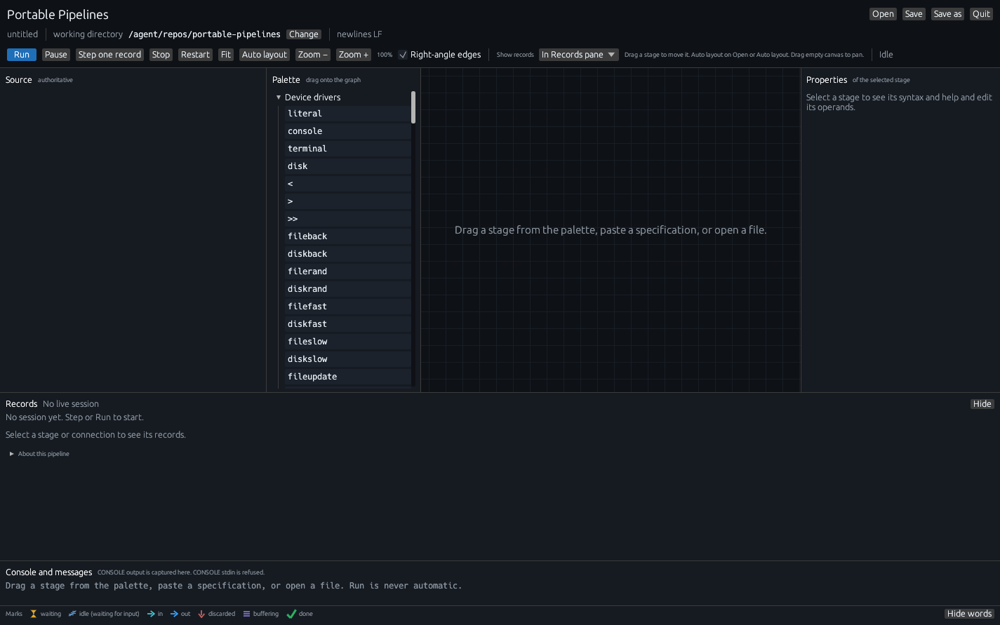
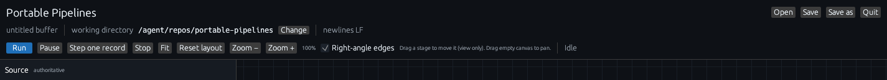
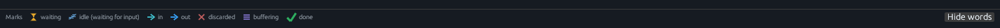

# The Portable Pipelines GUI

This is a long, friendly guide to `pipe --gui`: the Portable Pipelines
GUI. It is written for a pipelines user who is opening the window for
the first time and wants to *watch records move*.

The GitHub Release includes `pipe-gui` next to `pipe`. From the unpacked
folder, run `pipe --gui` (or `pipe --gui somefile.pipe`). `pipe --gui`
looks for `pipe-gui` in the same folder as `pipe`; it does not search
PATH.

It is a native desktop window. The program is a sibling of `pipe`
named `pipe-gui`. You launch it with `pipe --gui`, or by running
`pipe-gui` itself.

Records start moving when you press **Run** or **Step one record**.
Quit and the window close box abort the session.

The signed GitHub Release zip still ships `pipe` only. `--gui` is a
local-build preview until a later release includes `pipe-gui` on
purpose. From a clone of the same tree you already use for `pipe`:

```powershell
cargo build --release -p pipe-cli -p pipe-gui
.\target\release\pipe.exe --gui
.\target\release\pipe.exe --gui examples\marina\to-csv.pipe
```

```bash
cargo build --release -p pipe-cli -p pipe-gui
./target/release/pipe --gui
./target/release/pipe --gui examples/marina/to-csv.pipe
```

The window looks the same on Windows, macOS, and Linux.

## How this guide is laid out

1. This page: what the window is, how to launch it, a map of the chrome,
   and the one idea that makes everything else make sense.
2. [A first pipeline](gui/first-pipeline.md): a gentle tutorial. You
   paste three fruits, filter with LOCATE, press Step, then Run, and
   watch apple and apricot go through while banana is discarded.
3. [Worked walkthroughs](gui/walkthroughs.md): a multi-stream pipeline
   so secondary connections show; SORT so buffering shows; a Python
   (and REXX) stage so script info and **View script file** show; CSV
   and the marina example so a real spreadsheet of fields shows.
4. [Reference](gui/reference.md): every pane, button, mouse gesture,
   keyboard shortcut, mark, hover card, and Records grid, in one place.
5. [Glossary](gui/glossary.md): every mark, badge, heading, and status
   word the window paints.
6. [FAQ and troubleshooting](gui/faq.md): “why does this stage show
   zzz?”, renderer / Remote Desktop notes, and the usual first-day
   snags.

If you only have twenty minutes, read this page and the first-pipeline
tutorial. Come back to the walkthroughs when you want secondary streams,
SORT, or a `.py` stage under the microscope.

The same topics in shorter form live in the
[v0.2.0 release notes](release-notes-v0.2.0.md). JSON fields and CSV —
what the spreadsheet columns actually *mean* — are taught in
[JSON rows and CSV](json-and-fields.md).

## The one idea

A pipeline is stages connected by `|`. A record is written by one
stage and read by the next. Delay, filters, SORT, and a secondary
output are all consequences of that connector.

The GUI is a picture of that connector:

- Each box is a stage.
- Each line is one stream connecting a writer to a reader.
- A number on the left of a box (`→ 3`) is how many records that stage
  has **read**.
- A number on the right (`2 →`) is how many it has **sent**.
- An hourglass on a line means a record is sitting there, waiting to be
  read.
- zzz on a box means the stage is alive and has nothing to read yet.
- A green check means that stage has finished.
- A violet stack means the stage is **buffering**: it has read records
  and is holding them until it is ready to send (SORT and BUFFER do
  this).
- A red X means a record was discarded instead of sent (LOCATE’s
  non-match, when you left the secondary output unconnected).

Those marks are painted shapes, so they stay readable. The one-line
legend at the bottom of the window is the same vocabulary.



*Just after `pipe --gui`, before any specification. The graph says
“Paste a specification or open a file. The graph is drawn from source
without running it.”*

## Launch

### Windows (PowerShell)

From a clone. GNU host if you do not have Visual Studio Build Tools:

```powershell
# Without Visual Studio:
#   cargo +stable-x86_64-pc-windows-gnu build --release -p pipe-cli -p pipe-gui
cargo build --release -p pipe-cli -p pipe-gui
.\target\release\pipe.exe --gui
.\target\release\pipe.exe --gui examples\marina\to-csv.pipe
```

`pipe.exe` stays a console program. `pipe-gui.exe` is a Windows-subsystem
window next to it. `--gui` is parsed before the rest of the argv is
joined, so a path with spaces is one file argument when you quote it:

```powershell
.\target\release\pipe.exe --gui ".\docs\my file.pipe"
```

Working directory is the directory you launched from. Relative paths in
the spec (`examples\marina\vessels.jsonl`) resolve from that folder
unless you change **working directory** in the window and press Run
again.

`pipe.exe` prints `PIPE: starting …` before it waits for the window. If
the window fails to appear, that same console prints the GUI exit status
and a plain-language renderer error. `pipe-gui.exe` attaches to this
console so its own errors are not swallowed by the Windows subsystem.

The default renderer is `--renderer auto`: try wgpu first (Direct3D 12,
Vulkan, Metal, or GL), then OpenGL 2.0 via glow. Force one backend with
`--renderer wgpu`, `--renderer glow`, or `PIPE_GUI_RENDERER` (`auto`,
`wgpu`, or `glow`). The flag wins over the environment variable.
`pipe --gui --renderer glow` is forwarded to `pipe-gui`; it is treated
as a launch flag, not as pipeline text.

Noninteractive children owned by the GUI (Python/REXX helpers,
interpreter probes, COMMAND/SUBCOM `cmd /C` capture) set
`CREATE_NO_WINDOW` so they skip a cmd flash. Stdin/stdout/stderr
capture is unchanged. A GUI program you start from COMMAND still shows
its own window.

### Linux and macOS

```bash
cargo build --release -p pipe-cli -p pipe-gui
./target/release/pipe --gui
./target/release/pipe --gui examples/marina/to-csv.pipe
```

On Linux, wgpu typically talks to Vulkan; glow talks to OpenGL. The same
`--renderer` / `PIPE_GUI_RENDERER` overrides apply. You need a working
display (`DISPLAY` on X11, or a Wayland session the window can open on).

The GUI crate asks for Rust 1.85 because `egui` needs a current
compiler. The CLI and core crates still declare 1.75.
`cargo test` at the repo root (no `--workspace`) uses `default-members`
and skips `pipe-gui`. `cargo test --workspace` builds it and needs a
current stable toolchain.

If the window does not open, go to
[FAQ and troubleshooting](gui/faq.md#the-window-does-not-open).

## A map of the window

From the top:

**Title row.** “Portable Pipelines” and an italic subtitle. On the right:
**Open**, **Save**, **Save as**, **Quit**.

**File row.** The path, or `untitled buffer`, with `• unsaved` when the
text differs from disk. Then **working directory** and **Change**.
Then `newlines LF` or `newlines CRLF`, and `UTF-8 BOM` when a BOM is
present.

**Run row.**



- **Run** starts (or continues) a live debug session.
- **Pause** pauses at the next stage read, write, or short.
- **Step one record** starts the session if needed, then takes one
  record cycle.
- **Stop** ends the session. Already-written host files stay written.
- **Fit** recenters the camera.
- **Reset layout** clears view-only node drags and fits again.
- **Zoom −** / **Zoom +** and a percent.
- **Right-angle edges** (on by default): connections bend in the column
  gutter.
- A status word on the right: Idle, Running, Paused, Ended, Stopped, or
  Failed.

A hint sits next to the checkbox: *Drag a stage to move it (view only).
Drag empty canvas to pan.*

**Source** (left). The specification is authoritative. The graph is
drawn from it. Selecting a stage highlights that span and keeps the
bytes. A long one-line pipe wraps to the pane width.

**Graph** (center). Stage boxes, connections, in/out badges, and marks.
This is the picture you came for.

**Records** (under the graph). A run summary when nothing is selected;
the same spreadsheet you see on hover when a stage or connection is
selected. **Hide** gives the graph the space. **About this pipeline**
(collapsed) names scripts and files in plain language.

**Console and messages** (bottom). CONSOLE output is captured here.
CONSOLE stdin is refused (treated as end of file) so the window cannot
block on a hidden terminal.

**Marks** (very bottom). The legend. **Show words** / **Hide words**
toggles the labels next to the icons.



*The always-visible legend. Hover a mark for a one-line tooltip.*

## What to do first

1. Build `pipe` and `pipe-gui` as above, from the clone root.
2. Open the window with `pipe --gui`.
3. Follow [A first pipeline](gui/first-pipeline.md) with three fruits
   and LOCATE. You will press **Step one record** once, then **Run**,
   and read the in/out badges and the discard X.
4. When you want secondary streams, SORT, or a `.py` stage, use the
   [walkthroughs](gui/walkthroughs.md).

You can also open a file from the first second:

```powershell
.\target\release\pipe.exe --gui examples\marina\to-csv.pipe
```

```bash
./target/release/pipe --gui examples/marina/to-csv.pipe
```

The graph will fill in. Press **Run** when you are ready to write
`examples/marina/out/*.csv`.

Python and REXX stages are files you write (`examples\upper.py`). The
box shows the file name and the language. **View script file** reads
it from the working directory because you asked. That is a file view.

File stages take a host path (`notes.txt`, `examples\orders.csv`).
CONSOLE in this window captures output. Input is end of file. Use `<`
to feed a file, or LITERAL, or a Python/REXX producer.

## Where the rest of the docs live

| Page | What it is |
|---|---|
| [A first pipeline](gui/first-pipeline.md) | Tutorial. Three fruits and LOCATE. |
| [Walkthroughs](gui/walkthroughs.md) | Secondary streams, SORT, Python/REXX, CSV, marina. |
| [Reference](gui/reference.md) | Every control, in one place. |
| [Glossary](gui/glossary.md) | Every mark, badge, and label. |
| [FAQ and troubleshooting](gui/faq.md) | Why zzz, why Step prepares, renderer notes. |
| [JSON rows and CSV](json-and-fields.md) | What `$amount` and the spreadsheet columns mean. |
| [STATUS](STATUS.md) | Which built-in stages work today. |
| [examples/README](../examples/README.md) | Copy-paste pipelines from the command line. |
