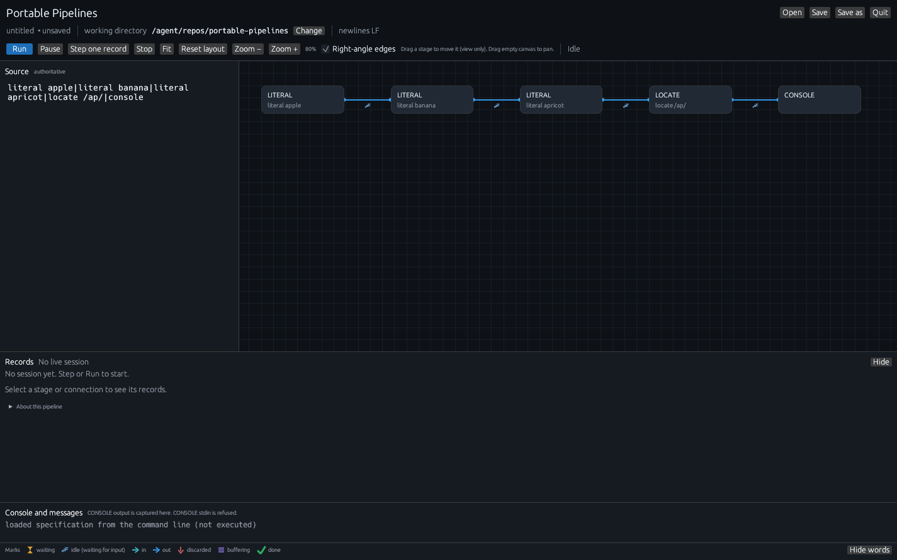
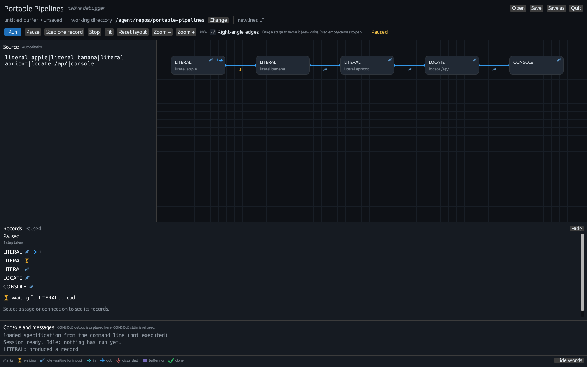
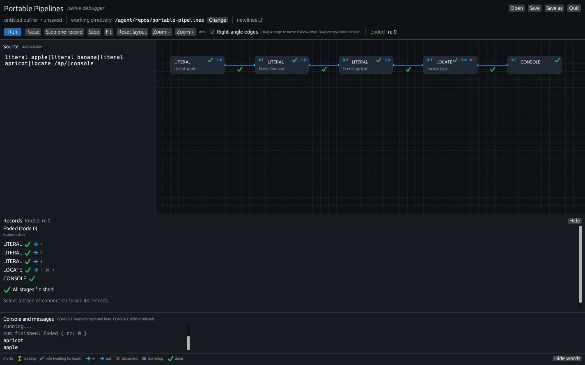
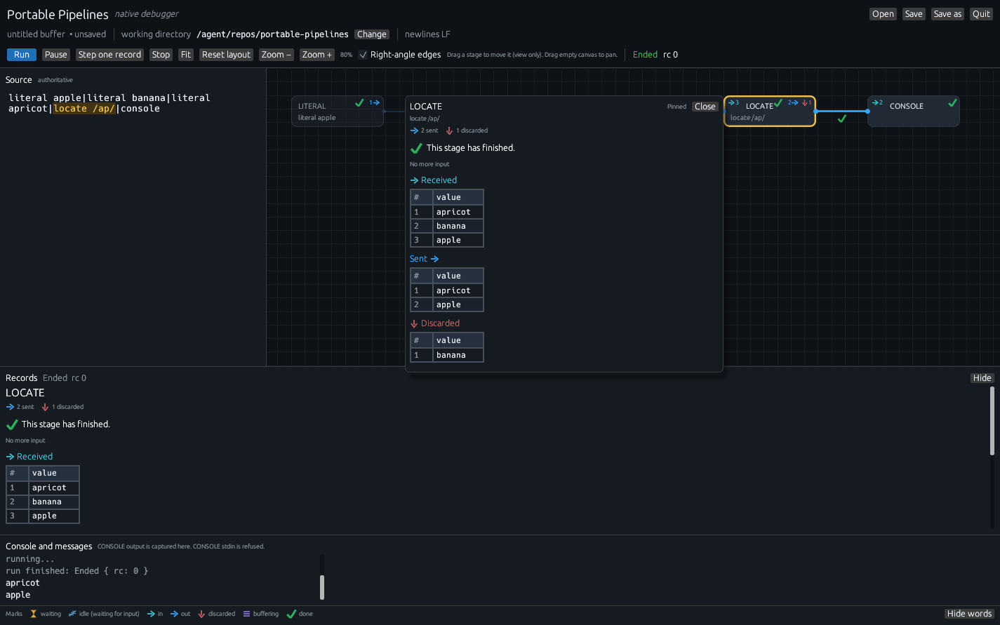
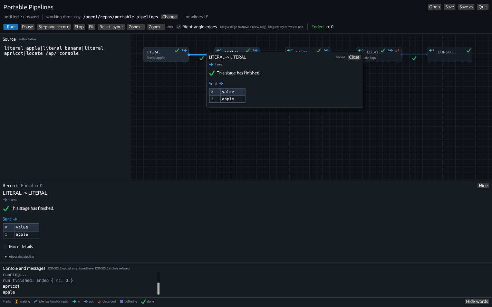
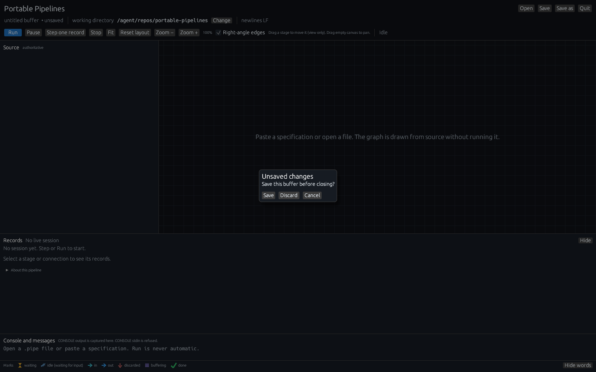

# A first pipeline

This chapter is a slow walk through one small pipeline in the GUI.
You will paste three fruit names, filter them with LOCATE,
press **Step one record** once so you can see the session come alive,
then press **Run** and watch two records go through while one is
discarded.

By the end you will recognize the in/out badges (`→ N` / `N →`), the
green checks (✓), 💤 vs the hourglass, the discard down-arrow (↓), the
hover peek (the default **Show records** setting), and the Records
pane.

If the window is not already open, start from
[The GUI](../gui.md#launch). Come back here with it open.

## What we will run

On Windows, from the unpacked folder that holds `pipe.exe`:

```bat
pipe --gui
```

On Linux and macOS:

```bash
pipe --gui
```

The window opens untitled. Source on the left is empty.
The graph says *Paste a specification or open a file. The graph is drawn
from source without running it.* Status is **Idle**. Records says *No
live session*.

Paste this specification into Source. The whole pipeline is one line;
the pane wraps so you can still read it.

```text
literal apple|literal banana|literal apricot|locate /ap/|console
```

On Windows, if you would rather launch already filled in:

```bat
pipe --gui
```

then paste. Or, from the command line, the same text is a `pipe`
pipeline you already know:

```bat
pipe "literal apple|literal banana|literal apricot|locate /ap/|console"
```

```bash
pipe "literal apple|literal banana|literal apricot|locate /ap/|console"
```

## The graph appears

As soon as the text parses, five boxes appear, left to right:

LITERAL (`literal apple`) → LITERAL (`literal banana`) → LITERAL
(`literal apricot`) → LOCATE (`locate /ap/`) → CONSOLE.

Connections are drawn as right-angle lines between the stage columns.
A small zzz sits on every live edge. Status is still **Idle**. Records
still says *No session yet. Step or Run to start.*



*The specification is drawn. The console notes that the specification
was loaded from the command line and was **not executed**.*

Notice that:

- Source is labelled **authoritative**. The boxes are a view of that
  text.
- The path reads `untitled  • unsaved`. Save when you want to; you can
  press Run either way.
- **Right-angle edges** is on.
- **Show records** is **In Records pane**, so hover is a short peek
  and the grids wait in Records until you click.
- The Marks legend is already visible along the bottom.

## Step once: the session prepares, then one record moves

Press **Step one record** (or F10).

Two things happen, in order, and both are visible in **Console and
messages**:

1. `Session ready. Idle: nothing has run yet.`
2. A line naming the stage that just moved, for example
   `LITERAL: produced a record`.

Status becomes **Paused**. The first LITERAL box gets a green check and
`1 →`. An amber hourglass sits on the connection into the second
LITERAL. The remaining boxes still show zzz. Records, with nothing
selected, lists each stage and says **Waiting for LITERAL to read**.



*One record cycle after the session was prepared. The hourglass is the
live pipe: a record is sitting there for the next LITERAL to read.*

> **Why Step prepares first.** A session is a real pipeline on a
> worker thread, with the same stages `pipe` would run. The first click
> of **Step one record** starts the session and then takes one record
> cycle: the selected stage if it can still run, otherwise a stage that
> has a record waiting. It skips a stage that has already ended. If
> nothing can move, the console names the stage that is waiting (for
> example **Waiting for tuck.py to read**).
>
> That is why the console says the session is ready and idle *before*
> it names a stage. The prepare is the moment the picture becomes a
> live session.

A record cycle is one stage doing one unit of work: producing a
LITERAL, reading and maybe writing, discarding, or noticing that input
has ended. Press Step a few more times if you want to walk apple,
banana, and apricot by hand. Or press **Run** and let the rest drain,
which is what we do next.

Pause and Stop stay usable the whole time. Pause takes effect at the
next stage read, write, or short.

## Run

Press **Run** (or F5, or Ctrl+Enter / ⌘+Enter).

The remaining stages run to completion. Status becomes **Ended rc 0**.
Every box has a green check. CONSOLE’s pane shows the records it
printed. Records, with nothing selected, lists each stage with its
marks and says **All stages finished.** **N steps taken** counts
**Step one record** clicks, so a session you mostly Run can still read
**0 steps taken** (or **1**, if you Stepped once first).



*The run summary with nothing selected. LOCATE is the interesting box:
it read three, sent two, discarded one.*

Read the badges on LOCATE, left to right:

- `→ 3` on the upper left: three records flowed **in**.
- `2 →` on the upper right: two records flowed **out**.
- `↓ 1` next to the out count: one record was discarded instead of
  sent.

That is `/ap/` against `apple`, `banana`, and `apricot`. Banana has no
`ap`, so LOCATE discards it. Apple and apricot go to CONSOLE.

Notice that apricot is listed in the console before apple. Chained
LITERAL stages emit right-to-left: each writes its own argument, then
copies whatever arrived from the left. That is how LITERAL is specified
in the Author’s Edition (1.1.11, around the LITERAL pages). The
GUI is showing you the order the stages actually wrote.

> **Why a stage shows a check, and why another shows zzz.** The check
> means “this stage has ended.” Banana’s discard is a separate
> down-arrow on LOCATE. A stage can finish after discarding everything; the check
> still appears. zzz means the stage is waiting for input. The check
> means it is done.

Hover the in-count or the out-count for a plain-language tooltip
(“records flowing into this stage”, “records this stage has sent”).
Multi-input stages name each source.

## Click LOCATE: the Records pane

Click the LOCATE box. Source highlights `locate /ap/`. The Records pane
below is the spreadsheet for that stage.



*Records is the only grid. Plain text is one column named **value**.*

Read the pane from the top:

- Title **LOCATE**.
- Small counts: `2 sent`, `1 discarded`.
- **This stage has finished.** with a green check, and *No more input*.
- **→ Received**: a spreadsheet. Column `#` is the row number. Column
  **value** is the record. Row 1 apricot, row 2 banana, row 3 apple —
  the order LOCATE actually read them. Drag a header border to resize
  a column.
- **Sent →**: apricot and apple, the records that went to CONSOLE.
- **↓ Discarded**: banana.

The headings put the mark on the side the records flowed: the in-arrow
before **Received**, the out-arrow after **Sent**, the down-arrow before
**Discarded**.

Hover the box without clicking and you get a short peek: **LOCATE**,
the full clause `locate /ap/`, a finished mark, `Read 3, wrote 2,
discarded 1`, and *Click to see records below.* The peek has no grid
and closes when the pointer leaves.

Hide Records with **Hide** if you want the graph taller; **Show**
brings it back.

If a stage has sent thousands of records, the sheet keeps the last
1000 and the heading says so: **Sent (showing last 1000 of 2500)**.
Row numbers keep the original sequence, so row 1501 is still record
1501.

## Click a connection: only that edge

Click the first connector, between `literal apple` and `literal banana`.
Records is titled **LITERAL → LITERAL**. You see what was sent on that
connection — here, `apple`. Hover the connection and the peek says
**LITERAL to LITERAL** and how many records crossed it.



*A connection is one stream from one writer to one reader.*

That matters more once a stage has two outputs. The
[multi-stream walkthrough](walkthroughs.md#secondary-streams-so-connections-show)
connects LOCATE’s secondary output; clicking that purple connection
shows banana and only banana.

## What you just learned, in one pass

| You saw | What it means |
|---|---|
| Graph appears, status Idle | Parsed, ready for Step or Run. |
| `Session ready. Idle: nothing has run yet.` | Step started the session. |
| Hourglass on a line  | A record is waiting to be read. |
| zzz 💤 on a box | Alive, nothing on input. |
| `→ 3` / `2 →` / `↓ 1` | Read 3, sent 2, discarded 1. |
| Green check ✓ | That stage has ended. |
| **→ Received** / **Sent →** / **↓ Discarded** | The same records as a spreadsheet. |
| Column **value** | These records are plain text. |
| CONSOLE pane | CONSOLE stdout is captured. Stdin is EOF. |

The Marks legend at the bottom is the same list. **Show words** labels
each icon; **Hide words** leaves the shapes.

## Save

The specification in Source is unsaved. **Save** writes it as a
`.pipe` or `.txt` file. **Quit** or the window close box will ask
**Save the Source text before closing?** with Save / Discard / Cancel.



*Discard closes without writing. Cancel leaves you in the window.*

Saving is about the specification in Source. The session is already
over (Ended rc 0). Host files the pipeline wrote (none, in this
example) stay written even if you Discard the Source text.

## Try the same pipeline from `pipe`, then come back

From the folder that holds `pipe`:

```bat
pipe "literal apple|literal banana|literal apricot|locate /ap/|console"
```

```bash
pipe "literal apple|literal banana|literal apricot|locate /ap/|console"
```

You should see apricot and apple on the terminal, in the same order the
CONSOLE pane showed. The GUI added marks and a spreadsheet.

## Where to go next

- [Secondary streams](walkthroughs.md#secondary-streams-so-connections-show),
  so banana takes the other connection.
- [SORT buffering](walkthroughs.md#sort-holds-records-until-input-ends),
  so you can see the violet stack and the sentence “SORT waits for all
  input before sending.”
- [A Python or REXX stage](walkthroughs.md#python-and-rexx-script-info-and-source-view),
  so you can read **View script file** without guessing.
- The [reference](reference.md), when you want Fit, zoom, keyboard
  shortcuts, and the renderer flags in one place.
- The [glossary](glossary.md), when a mark appears that this chapter
  did not pause on.
