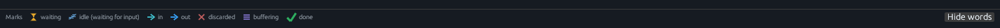

# Glossary of marks, badges, and labels

Everything the GUI paints as a name, a count, or a little shape. The
[tutorial](first-pipeline.md) shows these in motion. The
[reference](reference.md) explains the controls that surround them.
This page is the legend, written out.

Marks are painted shapes. If a screenshot in this guide looks like a
tiny hourglass, a zzz, an arrow, a down-arrow, a stack, or a check, that is
the same mark the window draws on your machine.

*The always-visible legend. **Show words** / **Hide words** toggles
the labels next to the icons.*

## Marks (the shapes)

### Hourglass — waiting 

A record is sitting at a stage’s input, waiting to be read. You will
see it on a connection in the graph, and as a line in Records such as
**Waiting for LITERAL to read**. Colour: amber.

This is the live pipe. If the same record also appears in a short
“recently sent” list, it is tagged **still waiting**.

Tooltip: *Hourglass: a record is waiting for a stage to read it.*

### zzz — idle 💤 (waiting for input)

The stage (or the connection’s reader) is alive and has nothing on
input. Colour: sleepy blue.

zzz is the usual look of a pipeline you have drawn and not yet run,
and of a downstream stage whose producer has not written yet. SORT
holding records still shows zzz on its *output* until it sends; the
holding is a stack on SORT itself.

Tooltip: *zzz: this stage is idle, waiting for input. It is not finished.*

> **Why zzz, and why a check.** Idle means the stage would work if a
> record arrived. Finished means it will do no more work. A HOLE
> sitting after SORT, while SORT buffers, is zzz. After SORT drains
> and ends, HOLE finishes and becomes a check.

### In-arrow — in (`→ N`) 

Records flowing **into** this stage: how many it has read. Painted on
the upper left of the box, arrow pointing **right** (with the flow).
Omitted on sources that have no pipeline input. Colour: cyan.

The badge digits have a leading space so the pair reads `→ 7`. Hover
the badge: *records flowing into this stage*. Multi-input stages name
each source.

Legend word: **in**.

### Out-arrow — out (`N →`) 

Records this stage has **sent**. Painted on the upper right of the
box, arrow pointing **right**. Colour: the window’s accent blue.

The badge digits have a trailing space so the pair reads `6 →`. Hover:
*records this stage has sent*.

Legend word: **out**.

Both in and out point right. Records flow left to right.

### Down-arrow — discarded ↓

The record was discarded instead of sent. On a box, a small down-arrow
and a count sit next to the out side (`↓ 1`). In a sheet, the heading
is **↓ Discarded**. Colour: grey-red.

LOCATE with the secondary output unconnected discards non-matches.
NLOCATE discards matches. Other stages discard when their contract
says so. Connecting stream 1 often sends those records on a
**secondary connection** instead. See
[Secondary streams](walkthroughs.md#secondary-streams-so-connections-show).

Tooltip: *Down arrow: the record was discarded instead of sent (shown as ↓ N, pointing down).*

### Stack — buffering 

The stage is holding records inside until it is ready to send. Colour:
violet. Three small bars.

SORT and BUFFER do this. The box shows the stack plus the known count
(`received − sent − discarded`). If that count cannot be known, the
stack still appears and the number is omitted.

The Records pane spells it out: **Buffering 1 record (SORT waits for all
input before sending)**. Hover is a short peek with the word
**buffering**.

Tooltip: *Stack: this stage is buffering records inside until it is ready to send.*

> **What buffering means.** Those records are inside the stage. They
> will be sent later, in the order that stage’s contract promises —
> sorted, for SORT; as a block, for BUFFER.

### Check — done ✓

This stage has finished. Colour: green. The check is drawn slightly
larger than the other marks so it stays a check at modest zoom.

A drained connection can show a check as well (the writer has
finished). Records, with nothing selected and every stage ended, says
**All stages finished.**

Tooltip: *Check: this stage has finished (done).*

A sender’s out-arrow plus an hourglass on anything still waiting
covers “read and passed on.”

## Headings in Records

These are the same marks, with words, at the top of each sheet.

| Heading | Mark placement | What the rows are |
|---|---|---|
| **→ Received** | Arrow before the word | Records this stage has read. |
| **Received on …** | Same | Read, named by input stream. |
| **Sent →** | Arrow after the word | Records this stage has sent (or sent on this connection). |
| **Sent on main output →** | Arrow after | Primary stream (stream 0). |
| **Sent on second output →** | Arrow after | Secondary stream (stream 1). |
| **Sent on stream N →** | Arrow after | Stream 2 and up. |
| **↓ Discarded** | Down-arrow before the word | Records thrown away instead of sent. |
| **Received (showing last 1000 of N)** | As Received | The sheet is capped; row numbers keep the original sequence. |
| **Sent (showing last 1000 of N)** | As Sent | Same cap on output history. |

**still waiting** (small amber hourglass + those words) next to a Sent
heading means the last sent record is also the live pipe: the next
stage has not read it yet.

**This stage has finished.** — green check line on a selected stage
that has ended.

**No more input** — the writer has closed; nothing else will arrive.

**Idle, waiting for input.** — zzz, selected stage or connection, live
but empty.

**No connection in this session.** — the edge you clicked is outside
the running topology (for example a drawing of a spec you have not
run, or a stream the session never opened).

**No session yet. Step or Run to start.** — Records, nothing running.

**Select a stage or connection to see its records.** — run summary
footer.

**Select a stage or connection.** — compact view with no focus.

**This connection only shows records sent on it.** — **More details**
for an edge.

## Spreadsheet labels

| Label | Meaning |
|---|---|
| `#` | Row number. When the sheet shows the last 1000 of 2500, the first `#` is 1501. |
| Header border | Drag to resize that column; the grid grows with it. Double-click to fit. |
| Grid frame edge | Drag the right or bottom edge of a grid to resize the frame. |
| **value** | Plain text (or CSV text, or any non-object) as a single column. |
| Field names (`customer`, `vessel_id`, …) | The record is a JSON object; columns are keys. |
| **binary** | Bytes shown as hex. |
| **empty record** | Zero-length record. |
| **empty object** | JSON `{}`. |
| **nested · …** | A nested JSON value; inspect from the Records pane. |
| **truncated for display (N bytes live)** | Preview cap; the live record is longer. |
| **Close** | Dismiss the script modal. |
| *Click to see records below.* | Last line of the graph peek. |

## Counts (the small counts under the Records title, and on the hover peek)

A selected stage or connection shows short counts under the title:

| Count | Meaning |
|---|---|
| `N sent` | Out-count for this focus. |
| `N discarded` | Discard-count. |
| `0 sent` | The stage has not written yet (SORT while buffering). |

The in-count usually lives in **→ Received** rather than as a count
on that row.

## Run-row and status words

| Word | Where | Meaning |
|---|---|---|
| **Portable Pipelines** | Title | The product. |
| **Open** / **Save** / **Save as** / **Quit** | Title row | File and shutdown. |
| **untitled** | File row | No path yet. |
| **• unsaved** | File row | Text differs from disk. |
| **working directory** | File row | Resolves relative paths in the spec and in script verbs. |
| **Change** | File row | Pick a different working directory. |
| **newlines LF** / **newlines CRLF** | File row | How the file stores line endings. |
| **UTF-8 BOM** | File row | A BOM is present. |
| **Run** | Run row | Start or continue the session. |
| **Pause** | Run row | Pause at the next read, write, or short. |
| **Step one record** | Run row | Prepare if needed, then one record cycle. |
| **Stop** | Run row | End the session. Host files already written stay. |
| **Fit** | Run row | Recenter the camera. |
| **Auto layout** | Run row | Place stages with the automatic layout and fit. |
| **Zoom −** / **Zoom +** | Run row | 45%–280%. |
| **nn%** | Run row | Current zoom. |
| **Right-angle edges** | Run row | Orthogonal connections in the gutter. |
| **Show records** | Run row | Where grids appear: **In Records pane** (default) or **On the graph**. Remembered between sessions. |
| **In Records pane** | Show records | Hover is a short peek; click fills Records. |
| **On the graph** | Show records | Hover shows the record grids on an interactive card. Records is a short hint. |
| *Drag a stage to move it. Auto layout on Open or Auto layout. Drag empty canvas to pan.* | Run row | Mouse hint. |
| **Idle** / **Running** / **Paused** / **Ended** / **Ended (rc)** / **Stopped** / **Failed** | Run row | Session status. |
| *Source has a parse error. Showing the last valid graph.* | Graph | Text does not parse; the last valid graph stays. |
| **rc N** | Records / Run row | Pipeline return code. 0 is success. |

## Source, graph, and panes

| Label | Meaning |
|---|---|
| **Source** | The specification text. |
| **authoritative** | The graph is a view of Source. |
| **Properties** | Docked pane for the selected stage: operands, syntax, help, connection-point words. |
| **Operands** | The text after the verb, as written in Source. |
| **Connection points** | Numbered inputs and outputs on a stage, including unused catalog streams. |
| **matched** / **unmatched** | LOCATE’s default words for output 0 and output 1. Display only. |
| **Records** | Run summary, or the selected stage/connection grid. |
| **Hide** / **Show** | Collapse or restore Records (In Records pane). |
| **No live session** | Records header when nothing has started. |
| **Ended rc 0** | Records header after a successful run. |
| **N steps taken** | How many times you pressed **Step one record**. Run leaves this at the Step count. |
| **More details** | Extra live/history lines under the sheets. |
| **About this pipeline** | Collapsed notes: scripts, files, CONSOLE, COMMAND. |
| **Console and messages** | GUI log + captured CONSOLE output. |
| *CONSOLE output is captured here. CONSOLE stdin is refused.* | Console subtitle. |
| **No output yet.** | Empty console. |
| **Marks** | The legend label. |
| **Show words** / **Hide words** | Legend labels on or off. |
| **secondary** | Fallback connection label for stream 1 when the catalog has no word. |
| **stream N** | Fallback connection label for stream 2 and up. |
| **CALLPIPE connector** | A connector node. |
| **L: LOCATE** | A labelled stage (label `L`, verb LOCATE). |
| **LITERAL → LITERAL** | A selected connection’s title. |
| **L: LOCATE → HOLE** | Same, with labels. |
| **unknown verb** | Red box: needs a built-in or a `.py` / `.rexx` / `.rex` path. |
| **Unknown verb: not a built-in stage and not a .py/.rexx script.** | Records, selected unknown. |
| **unknown stage NAME (still shown; Run will fail until it is registered)** | Warning line. |

## Script identity and source view

| Label | Meaning |
|---|---|
| **upper.py** / **upper.rexx** | Box title: the file name. |
| **Python** / **REXX** | Box subtitle, and the language line in Records. |
| **View script file** | Button and right-click item. Reads the file from disk. |
| **as written:** | The verb exactly as Source spelled it. |
| **resolved from working directory:** | Absolute path the helper uses. |
| **arguments:** | Bytes after the path in the clause. |
| *File is not opened until you choose View script file. Interpreter locals are not available.* | Hover and the graph leave the file closed. |
| **Python —** *path* | Modal title. |
| *Read from disk. Working directory:* | Modal subtitle. |
| *Not interpreter locals, and not a live step inside the script.* | Modal contract. |
| **Step this stage** | Right-click: one record cycle targeting this box. |
| **Reset this node position** | Right-click: put this stage back on the automatic layout. |
| **Fit graph** | Right-click empty canvas. |

## Dialogs and pickers

| Label | Meaning |
|---|---|
| **Unsaved changes** | Quit / close with unsaved Source text. |
| **Save the Source text before closing?** | The question. |
| **Save** / **Discard** / **Cancel** | The answers. Discard closes without writing. |
| **Open pipeline** / **Save as** / **Working directory** | Picker titles. |
| **Parent** | Up one folder. |
| **Use this folder** | Confirm a working-directory pick. |
| **Name** | File name field in Save as. |
| **Pipeline** | File filter: `.pipe`, `.txt`. |

## Console sentences you will actually see

These are log lines, not marks, but they are easy to search for.

| Line | When |
|---|---|
| `loaded specification from the command line (not executed)` | `--gui` with a spec or file; graph drawn only. |
| `Open a .pipe file or paste a specification. Run is never automatic.` | Empty window. |
| `Session ready. Idle: nothing has run yet.` | Step or Run just prepared the worker. |
| `LITERAL: produced a record` | A Step cycle. |
| `SORT: read a record and is buffering it` | SORT took input and held it. |
| `Run requested. Side effects happen now if the spec writes files.` | You pressed Run. |
| `running...` | Worker is in a cycle. |
| `Started again.` | Run, Step, or Restart after Finished or Stop. |
| `Finished. Return code 0.` | Success. |
| `error: unknown stage: PYTHON` | The verb was `python …`, not a `.py` path. |
| `Waiting for NAME to read` | Step could not move; that stage has a record or is blocked. |

## About this pipeline (plain-language notes)

| Sentence | Meaning |
|---|---|
| *Each Step moves one record through one stage. A stage can have more than one input or output.* | How Step works. |
| *NAME is a Python script; it only runs when you Step or Run* | When the helper starts. |
| *NAME is a REXX script; it only runs when you Step or Run* | When the helper starts. |
| *Reads files: …* | `<` paths in the spec. |
| *Writes files: …* | `>` / `>>` paths. |
| *CONSOLE output appears in this window. The window does not read a hidden terminal.* | Stdin is EOF. |
| *A COMMAND stage may run a program on this computer when you Step or Run.* | When the shell starts. |

Side-effect tags on stages (in warnings, not always in About):
**writes a host file**, **reads a host file**, **reads or writes the
host console**, **may run a host command**, **nested PIPE text is
data, not a graph**.

## Nearby words

| You might look for | What this window says |
|---|---|
| Breakpoint | **Step one record** and Pause. |
| Step into Python | **View script file** (bytes on disk). |
| `PYTHON` as a built-in | A `.py` **path** as the verb. |

If a word on screen is not on this page, it is probably a stage name
(LITERAL, LOCATE, SORT) or a field name from your JSON. Stage names
are the verbs; field names are yours. [STATUS](../STATUS.md) lists
which built-ins work today.
