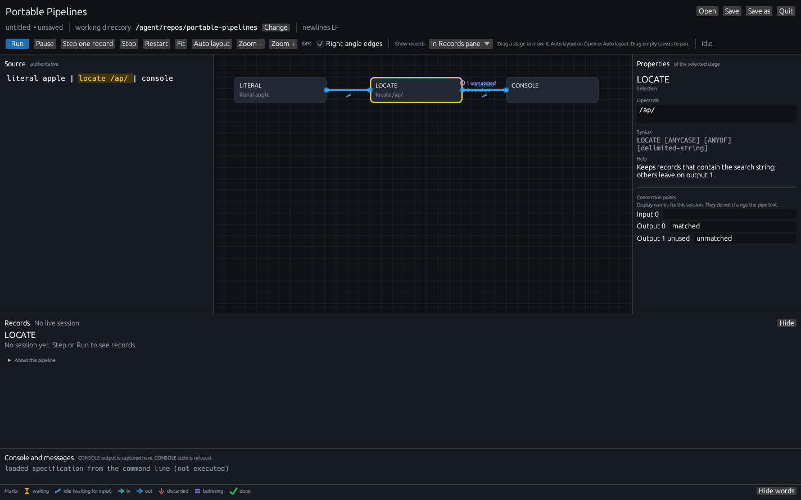
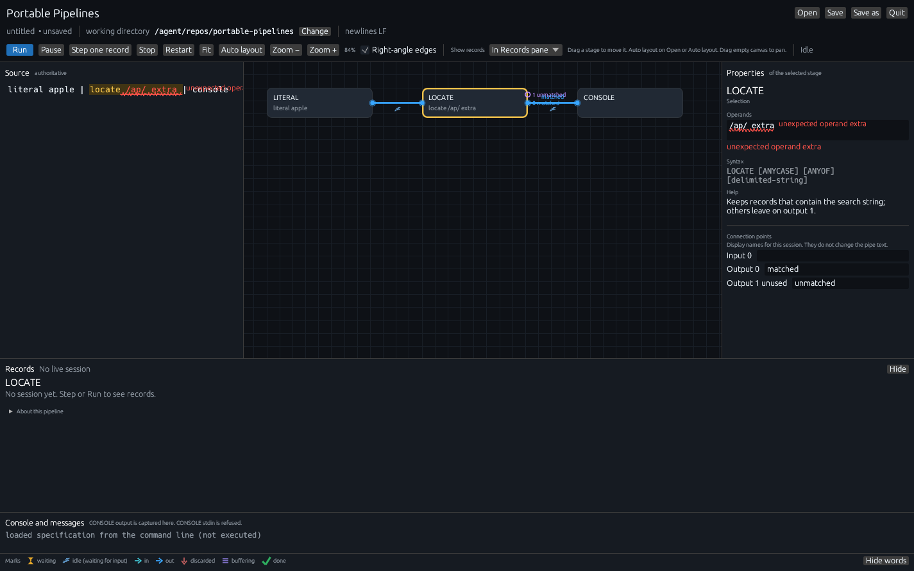
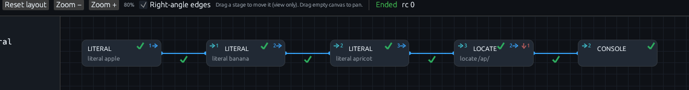
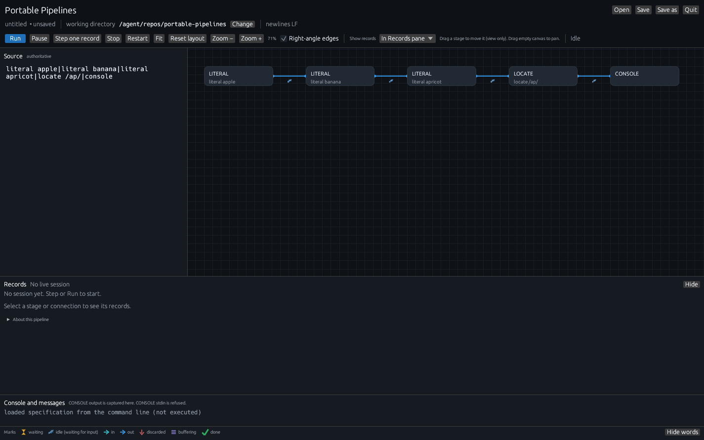
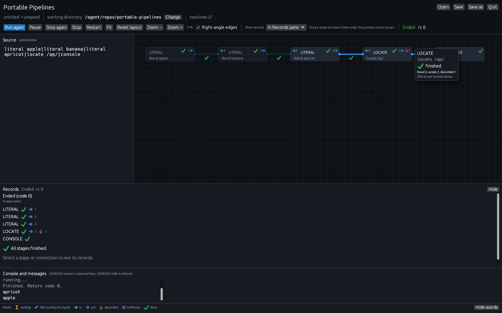
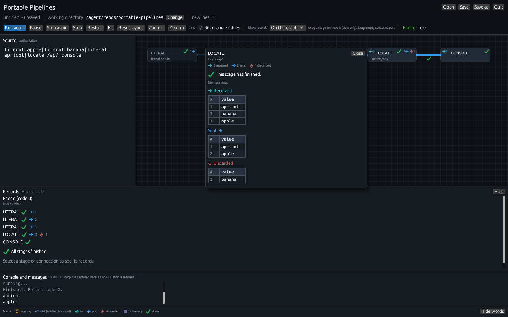

# GUI reference

This page is the Portable Pipelines GUI, control by control. The
[tutorial](first-pipeline.md) and [walkthroughs](walkthroughs.md) are
the guided tour. If you are hunting for one checkbox, start from the
list below.

1. [Launch and files](#launch-and-files)
2. [The Source pane](#the-source-pane)
3. [The Properties pane](#the-properties-pane)
4. [Run, Step, Pause, Stop, Quit](#run-step-pause-stop-quit)
5. [The graph](#the-graph)
6. [Marks and badges](#marks-and-badges)
7. [Hover and Show records](#hover-and-show-records)
8. [The Records pane](#the-records-pane)
9. [The spreadsheet](#the-spreadsheet)
10. [Console and messages](#console-and-messages)
11. [Python, REXX, and COMMAND](#python-rexx-and-command)
12. [Keyboard](#keyboard)
13. [Renderer](#renderer)
14. [Limits](#limits)

The [glossary](glossary.md) is the same vocabulary as a table. The
[FAQ](faq.md) is symptoms and causes.

## Launch and files

`pipe --gui` starts sibling `pipe-gui` and waits until that window
closes. `pipe-gui` can also be started on its own. The window title and
taskbar use the Portable Pipelines site logo. One optional file
argument is the specification to open:

```bat
pipe --gui
pipe --gui examples\marina\to-csv.pipe
pipe --gui "docs\my file.pipe"
```

```bash
pipe --gui
pipe --gui examples/marina/to-csv.pipe
```

`--gui` is parsed before the rest of argv is joined, so a quoted path
with spaces stays one file. Working directory is the directory you
launched from. Relative paths in the spec resolve from that folder
until you press **Change** next to **working directory** and then Stop
and Run.

**Open** / **Save** / **Save as** use a small picker (Pipeline filter:
`.pipe` and `.txt`). The file holds only the pipeline text. **Save as**
adds a `.pipe` extension when the name has none. **newlines LF** or
**newlines CRLF** follows the file. **UTF-8 BOM** appears when a BOM is
present.

`untitled  • unsaved` means the Source text has no file yet, or
differs from disk. Quit and the window close box ask **Save the
Source text before closing?** — Save / Discard / Cancel. Discard
takes effect. Cancel and a failed Save leave Source open.

An edit to Source while a session is running or paused stops the run.
The next Run or Step starts from the beginning. Pipes run only on Run
or Step.

The GitHub Release includes `pipe-gui` next to `pipe`. `pipe --gui`
looks for it in the same folder as `pipe`, not on PATH. Building from
a clone is in [CONTRIBUTING.md](../../CONTRIBUTING.md).

## The Source pane

Source is labelled **authoritative**. The graph is drawn from these
bytes. Selecting a stage highlights that stage's text in Source. A
long one-line pipe wraps to the pane width so it stays readable.

Paste, type, or Open a file. A parse error keeps the last valid graph
and underlines the error in Source. After records have flowed, a
`$field` in a stage's operands that is not among the fields seen on
its input is squiggled in Source, with a hint such as
`no field owner_i in the input; did you mean owner_id?`. Unknown verbs
show up in Records and in **Console and messages**. An unknown verb is
still drawn (often in a red box) so you can see where it sits; Run
fails until it is a built-in or a `.py` / `.rexx` / `.rex` path.

A stage whose operands fail a checker (the first batch: LITERAL,
LOCATE, NLOCATE, TAKE, DROP, CHANGE, SPECS, CONSOLE, the file drivers,
and COUNT) gets the same red squiggle and message on those operands in
Source. Stages with no checker yet, and Python or REXX stages, are not
checked as you type.

## The Properties pane

The right-hand pane is **Properties**. It is docked, like a Visual
Studio property sheet. Click a stage on the graph (or in Source) to
fill it.

**Operands** is one line: the text after the verb, exactly as it
appears in Source. Edit it there and Source is patched in place; the
graph follows. The catalog **syntax** line and a short **help**
sentence sit under that field.

A checker that rejects the operands underlines them in Properties and
in Source with the same squiggle. Python and REXX stage operands are
never checked.

**Connection points** lists each numbered input and output the catalog
knows about, including unused ones (LOCATE’s output 1 **unmatched** on
a one-line pipe). The word next to the number is a display name for
this session. Changing it does not rewrite the pipe text.

Separate fields for stages with many options are not in this release.



*Click LOCATE. Operands are `/ap/`. Output 1 is unused and labelled unmatched.*



*LOCATE `/ap/ extra` is rejected as you type. SORT and other stages without a checker stay quiet.*

## Run, Step, Pause, Stop, Quit

**Run** starts a real session on a worker thread. If a session is
already paused, Run continues it. After Finished or Stop the button
reads **Run again**: it starts a fresh full run from the top. The
console says `Started again.` then `Finished. Return code N.` when
the run completes.

**Step one record** starts the session if needed, then takes one record
cycle: the selected stage if it can still run, otherwise a stage that
has a record waiting. It skips a stage that has already ended. If
nothing can move, the console names the stage that is waiting. If Run
is still going, Step pauses at the next record. After Finished or Stop
the button reads **Step again**: it starts a fresh session and takes
the first record.

The first Step click therefore does two jobs: it prepares the session,
and it takes a cycle. The console says `Session ready. Idle: nothing
has run yet.` and then names the stage that moved. See
[Why Step prepares first](first-pipeline.md#step-once-the-session-prepares-then-one-record-moves)
in the tutorial.

**Restart** prepares a new session from the top without running it.
Source text and stage positions stay. Graph marks, counts, record
history, and the Records pane reset. The console says `Started again.`

**Pause** takes effect at the next stage read, write, or short.

**Stop** ends the session. Already-written host files stay written.
After Stop, Step or Run starts over; you do not need to quit the window.

**Quit** (and the window close box) abort the session. A host file
syscall already in flight is given a few seconds; then the process
exits so `pipe --gui` can return. Python/REXX helpers park between
protocol frames so Stop/Quit can terminate the helper child.

Status words, painted next to the Run row:

| Status | Meaning |
|---|---|
| Idle | No live session, or a session that has not started work. |
| Running | The worker is in a record cycle. |
| Paused | Waiting for Run or Step. |
| Ended | The pipeline finished. `rc 0` is success; `Ended (rc)` otherwise. |
| Stopped | You pressed Stop. |
| Failed | The session aborted with a message. |

Records repeats the same facts as **Ended rc 0**, **Stopped  rc N**,
**Failed: …**, or **Idle — nothing has run yet**.

## The graph

Each box is a stage. The title is the verb (or the script file name).
The subtitle is the rest of the clause (`literal apple`, `locate /ap/`,
`Python`, `csv write`). A labelled stage shows `L: LOCATE`. A CALLPIPE
connector is drawn as a connector. When the subtitle is longer than the
box, it is cut with a visible "…". File stages (`<`, `>`, `>>`, and the
DISK/FILE family) keep the end of the path so the file name stays
readable (`…/marina/vessels.jsonl`). Hover a box to see the full clause.

Grab empty canvas with the primary mouse button to pan. Drag a stage to
reposition it; connections follow. The placed position is for this
session only and is not written to the file. Click (no
drag) still selects the stage and syncs the Source highlight. Selected
or hovered stages highlight their input/output paths and dim the rest.

**Fit** recenters the camera on the current layout (including any
drags) without shrinking titles unreadably.

**Auto layout** places stages with the automatic layout and fits.
Open a file also auto-layouts. A dragged stage stays where you put it
until you Open or press **Auto layout**.

**Zoom −** / **Zoom +** clamp between 45% and 280%. The percent is
shown next to the buttons.

**Right-angle edges** (default on) bends connections in the column
gutter. Off, connections are straight. Stream 1 is drawn in a second
colour. Connection points are numbered; the catalog’s default word
(LOCATE output 0 **matched**, output 1 **unmatched**) is painted next
to the point and on the connection when that stream is used. You can
rename a word in Properties for this session only. Stream 1 still
falls back to **secondary** when the catalog has no word; stream 2
and up say **stream N**. Unused catalog points are hollow circles so
you can see a stream that is not connected.

**Show records** (default **In Records pane**) chooses where the
record grids appear. See [Hover and Show records](#hover-and-show-records).
The setting is remembered between sessions. **Run again**, **Step
again**, and **Restart** do not change it.

Right-click a stage: **Step this stage**, **View script file** (when
the verb is a `.py` / `.rexx` / `.rex` path), **Reset this node
position**. Right-click empty canvas: **Fit graph**.

## Marks and badges

Marks are painted shapes. Idle is a painted zzz (💤). Done is a painted
green check (✓). Discarded is a painted down-arrow (↓).



*In-counts sit on the upper left and point right (`→ 3`). Out-counts
sit on the upper right and point right (`2 →`). Both arrows point
with the flow, left to right.*

| Mark | Where you see it | Meaning |
|---|---|---|
| Amber hourglass  | On a connection; in Records | A record is sitting at a stage’s input, not yet read. |
| Cyan zzz 💤 | On a live stage or connection; in Records | Idle, waiting for input. |
| Cyan in-arrow  | Badge `→ N` on the upper left of a box | Records this stage has read. Omitted on sources with no input. |
| Accent out-arrow  | Badge `N →` on the upper right | Records this stage has sent. |
| Grey-red down-arrow ↓ | Next to the out side; in sheets | The record was discarded instead of sent. |
| Violet stack  | On a buffering box; in Records | Records kept inside until the stage is ready to send. |
| Green check ✓ | On a finished box; on a drained connection | This stage (or writer) has finished. |

A sender’s arrow count plus an hourglass on anything still waiting
covers “read and passed on.”

The buffering count is `received − sent − discarded` when that number
can be known. SORT and BUFFER wait for all input before sending; the
box shows the stack plus that count. If the count cannot be known, the
stack still appears and the number is omitted.

The in-badge is omitted on a source that has no pipeline input (a
LITERAL that only produces, a `<` that only reads a host file). Those
boxes still show an out-count once they have sent. Hover a count for a
plain-language tooltip; multi-input stages name each source.

The legend at the bottom of the window is this same list. **Show
words** / **Hide words** toggles the labels. Hover a legend icon for
the tooltip.

A full table, including heading text (**→ Received**, **Sent →**,
**still waiting**), is in the [glossary](glossary.md).

## Hover and Show records

**Show records** on the Run row has two choices.



**In Records pane** (default). Hover a stage or a connection. After a
short delay a small tooltip opens next to the pointer. It has no
record grid. For a stage it shows the name, the full clause (for
example `< examples/marina/vessels.jsonl`), the status mark with its
word (finished, idle, waiting, buffering), and the in/out counts in
plain words (`Read 5, wrote 5`). For a connection it shows which
stages it joins and how many records crossed it. The last line is
always *Click to see records below.* The peek closes when the pointer
leaves the stage or connection. It does not stay open if you move
onto it. Click the stage or connection to select it; the grids appear
in the Records pane.



**On the graph.** Hover a stage or a connection and, after the same
short delay, a larger card opens against it. The card includes the
record grids (Received first, then Sent, then Discarded ↓ when
anything was discarded). Move the pointer onto the card to scroll or
select cells; it stays open while you do that. Click still selects
the stage or connection. Grids do not appear in the Records pane in
this mode; that pane is a short hint (*Records show on the graph.
Switch Show records to In Records pane to see them here.*). Switch
**Show records** back to **In Records pane** to see the grids there
again, for the stage or connection that is selected. Escape or
**Close** dismisses a pinned card.



## The Records pane

**Records** is a resizable, collapsible pane under the graph. **Hide**
/ **Show** toggle it.

When **Show records** is **On the graph**, Records is a short hint
instead of grids. Switch back to **In Records pane** to restore the
pane and its grids immediately.

With nothing selected it is a run summary: status, steps taken,
per-stage marks, and where a record is waiting. If every stage has
ended it says **All stages finished.** If the session is live and
nothing is waiting it says **Idle, waiting for input**. Otherwise each
waiting connection gets an hourglass line such as **Waiting for
LITERAL to read**. At the bottom: *Select a stage or connection to see
its records.*

If a stage looked up a `$field` that was not on the record, that
stage's box is marked and Records shows the warning on that stage
(`LOOKUP (stage 3): field $owner_i not found…`), not only on a later
stage that failed. The same line is in **Console and messages**.

With a stage or connection selected it is the record grid: small
counts, holding sentence, then data-flow order. **→ Received** comes
first (a waiting-to-read line stays with this section, then the
received sheet). **Sent →** is next (a waiting-for-the-next-stage
line stays with this section, then the sent sheet). **↓ Discarded**
is last. Then optional **More details**. A connection has no Received
section; it is Sent (and Discarded) only.

**More details** is a checkbox. For a stage it adds live name, last
step, connections, recent history. For a connection it reminds you
that the connection shows records sent on it.

**About this pipeline** (collapsed) names, in plain language:

- How Step works: *Each Step moves one record through one stage. A
  stage can have more than one input or output.*
- Python and REXX files, and that they run when you Step or Run.
- Files the spec reads (`<`) and writes (`>`, `>>`).
- CONSOLE: output appears in this window; stdin is end of file.
- COMMAND / PIPECMD / SUBCOM: may run a program on this computer when
  you Step or Run.

## The spreadsheet

The Records pane is the usual home for the grid. **On the graph** shows
that same grid on the hover card only (Records is a short hint). It
auto-picks from the bytes:

| The record looks like | The sheet shows |
|---|---|
| JSON object | One column per field name (`customer`, `amount`, …). |
| Plain text | One column named **value**. |
| Binary | Hex, with a small **binary** label. |
| Empty | *empty record*. |
| Nested JSON in a cell | A nested summary you can inspect in the Records pane. |

A raw CSV header line stays in one **value** column. Parse it with
`csv` first; the **Sent →** sheet then uses the field names. See the
[CSV walkthrough](walkthroughs.md#spreadsheet-columns-csv-in-json-objects-out).

Header row, row numbers, cell borders, stripes, sticky header. Long
cells ellipsize; the full value is on hover. Drag the right border of a
column header to widen or narrow that column (a resize cursor appears
on the border). The grid frame grows with the columns. Nested grids
(owner, berth, work_orders, …) do the same. Drag the grid’s right or
bottom edge to resize the frame itself. Columns have a short minimum
width so they stay readable. Double-click the border to fit the column
to its contents. Widths stay as you Step or Run, and are remembered
per stage or connection — **→ Received**, **Sent →**, and **↓
Discarded** each keep their own — for this session and the next time
you open the window. When a grid is wider than the Records pane or the
hover card, that pane or card scrolls. Thin solid ~6 px scroll bars
sit beside the cells so they never cover text.

The sheet keeps the last 1000 records. If a stage sent 2500, the
heading reads **Sent (showing last 1000 of 2500)** and the first row
number is 1501. The live pipe — the record still waiting to be read —
is a separate hourglass row. If that waiting record is also in the
short recent list, it is tagged **still waiting**.

If you expected field columns and see **value**, you are looking at
raw text before a CSV/JSON stage, or at records that are still plain
text.

## Console and messages

**Console and messages** captures two streams:

- Log lines from the GUI itself: specification loaded (not executed),
  session ready, Run requested, side-effect notice, stage notes,
  `Started again.`, `Finished. Return code 0.`, parser errors.
- CONSOLE stage output, as `pipe` would have printed it.

CONSOLE **stdin is refused** (treated as end of file) so the window
cannot block on a hidden terminal. Feed records with LITERAL, `<`,
or a producer stage. The pane’s own subtitle says this.

A new Run after the session has ended clears the console.

## Python, REXX, and COMMAND

A stage whose verb is a path ending in `.py`, `.rexx`, or `.rex` is a
language stage. The box title is the file name (`upper.py`). The
subtitle is the language (`Python`, `REXX`). Arguments after the path
show in Records as **arguments:**.

**View script file** (Records pane or right-click) reads the path
resolved from the working directory you chose. The modal says *Read
from disk. Working directory:* and *Not interpreter locals, and not a
live step inside the script.* Close the modal and open it again to
re-read after an external edit.

On Windows, GUI-owned helper children (Python, REXX, interpreter
probes, COMMAND/SUBCOM `cmd /C` capture) set `CREATE_NO_WINDOW` so
they skip a cmd flash. Stdin/stdout/stderr capture is unchanged. A GUI
program started from COMMAND still shows its own window.

COMMAND / PIPECMD / SUBCOM may run a host program when you Step or
Run. **About this pipeline** says so.

Write the file path as the verb (`examples/upper.py`). The
[Python walkthrough](walkthroughs.md#python-and-rexx-script-info-and-source-view)
shows the Records pane and **View script file**.

Python needs 3.10+ on the machine (`PIPE_PYTHON`, then `py -3` on
Windows, then `python3`, then `python`). REXX on Windows uses bundled
Regina in the release zip; on Linux and macOS install Regina for full
behaviour, otherwise the embedded subset runs. See
[v0.2.0 requirements](../release-notes-v0.2.0.md#requirements).

## Keyboard

| Key | Action |
|---|---|
| F5 | Run |
| Ctrl+Enter (⌘+Enter) | Run |
| F10 | Step one record (after Finished or Stop: start again) |
| Shift+F5 | Stop |
| Ctrl+S (⌘+S) | Save |
| Ctrl+O (⌘+O) | Open |
| Esc | Close a modal (unsaved, script file, picker) |

Mouse:

| Gesture | Action |
|---|---|
| Drag empty canvas | Pan |
| Drag a stage | Move it (this session; Auto layout on Open or Auto layout) |
| Click a stage or connection | Select; show its grids in Records; highlight Source |
| Hover a stage or connection | Short peek (name, clause, status, counts) |
| Hover an in/out badge | Tooltip |
| Right-click a stage | Stage menu |
| Right-click empty canvas | Fit graph |
| Scroll bars on a sheet | Scroll the Records grid |

## Renderer

The default is `--renderer auto`: try wgpu first (Direct3D 12,
Vulkan, Metal, or GL, with automatic GPU fallback), then OpenGL 2.0
via glow in the same process. Forced backends stay on that backend.

```bat
pipe --gui
pipe --gui --renderer wgpu
pipe --gui --renderer glow
set PIPE_GUI_RENDERER=glow
pipe --gui
```

```bash
pipe --gui
pipe --gui --renderer wgpu
pipe --gui --renderer glow
PIPE_GUI_RENDERER=glow pipe --gui
```

The flag wins over `PIPE_GUI_RENDERER`. `pipe --gui --renderer glow`
is forwarded to `pipe-gui`; it is a launch flag.

On some Windows laptops, OpenGL 2.0 is missing when you sit at the
machine (even with a healthy NVIDIA adapter and Microsoft Basic
Display Adapter in Device Manager) while the same binary opens over
Remote Desktop. wgpu prefers Direct3D 12 in that situation. If both
backends fail, the `pipe --gui` console names each cause and how to
override. Walk the flags once at the laptop and once over RDP.

`--renderer wgpu` is the check that Direct3D/Vulkan/Metal/GL-via-wgpu
alone can open the window. `--renderer glow` is the OpenGL path.

## Limits

- **View script file** is bytes on disk.
- CONSOLE stdin is end of file. Feed records with LITERAL, `<`, or a
  producer.
- Quit aborts the session.
- CSV field columns appear after a `csv` stage has parsed the header.
- Operand checkers cover a first batch of common stages. Other built-ins
  show no squiggle until a checker exists. Python and REXX operands are
  never checked.
- Connection-point words are session-only; they are not saved in the
  file.
- Every specification in this guide is a legal `pipe "…"` pipeline.
  The window is how you watch.

The [FAQ](faq.md) is the shorter form of those sentences, as questions.
