# Worked walkthroughs

The [first-pipeline tutorial](first-pipeline.md) is a straight filter:
three fruits, LOCATE `/ap/`, banana discarded. This page adds the
pictures that only appear once the topology is a little richer.

1. A **secondary output**, so lanes show and banana is no longer an X.
2. **SORT**, so the violet buffering stack shows, and you can see why
   a stage reads without sending.
3. A **Python** stage (and the same walkthrough with **REXX**), so
   script identity and **View script file** show.
4. **CSV / JSON fields** and the marina example, so the spreadsheet
   grows real column names.

Each walkthrough is a specification you can paste. Looking at the graph
still does not run it. Press **Run** (or **Step one record**) when you
want records to move.

Launch, if the window is not already open:

```powershell
.\target\release\pipe.exe --gui
```

```bash
./target/release/pipe --gui
```

## Secondary streams, so lanes show

On CMS, LOCATE’s primary output is the records that matched. Connect a
secondary output and the non-matches go there instead of being
discarded. Portable Pipelines does the same. The debugger draws that
second connector as its own lane — a second colour, a little label
**secondary**, a right-angle path that does not sit on top of the
primary line.

Paste:

```text
(ENDCHAR ?) literal apple|literal banana|literal apricot | L: locate /ap/ | hole ? L: | hole
```

That is one pipeline, split at `?` because we used `(ENDCHAR ?)`. The
first pipeline is the three fruits into labelled LOCATE `L:` and then a
HOLE. The second pipeline is `L:`’s secondary output into another HOLE.
HOLE reads and throws away; it is a quiet sink so we can watch the
lanes without CONSOLE filling up.

Press **Run**. Click the LOCATE box (`L: LOCATE`).

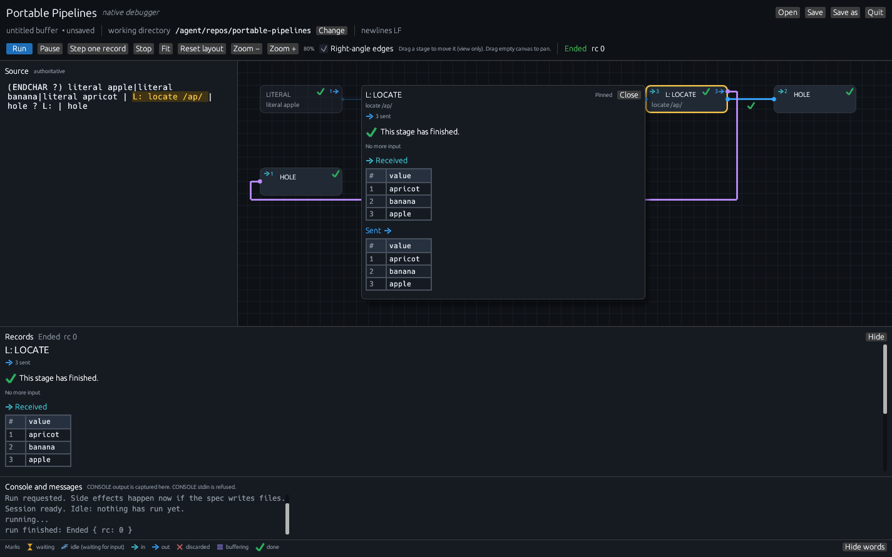

*Banana is not discarded. LOCATE sent three records: two on the primary
stream, one on the secondary. Captured on Linux.*

Compare this with the first tutorial. There, LOCATE showed `→ 3`,
`2 →`, and `✕ 1`. Here the box shows three in and three out, and there
is no X. The non-match still left LOCATE; it just left through a
different connector.

The primary HOLE on the right has `→ 2`. The secondary HOLE below has
`→ 1`. Those in-counts are the two matches and the one miss.

Click the **purple** connection — the one labelled **secondary**.

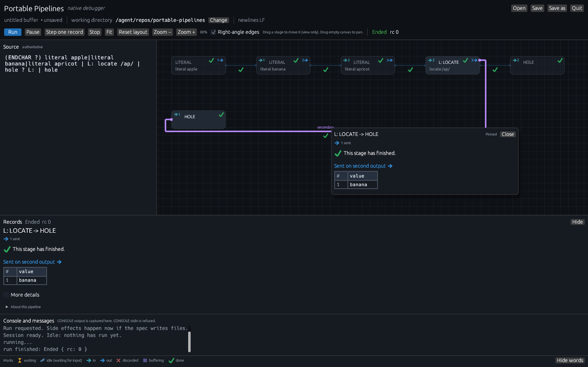

*One connection, one stream. The card says **Sent on second output**
and the only row is banana. Captured on Linux.*

Click the primary connection from LOCATE to the HOLE on the right.

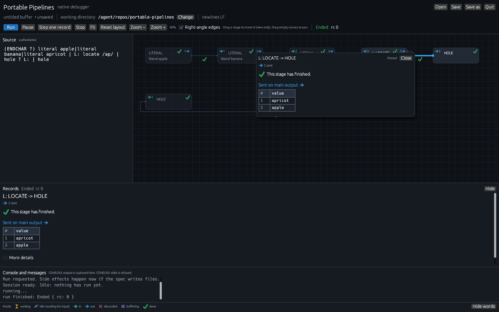

*The other connector from the same LOCATE. Apricot and apple only.
Captured on Linux.*

A connection never shows “everything that stage did.” It shows what
was written on *that* stream. That is why banana does not appear on
the primary card, and why apple does not appear on the secondary card.

> **Why the lane is offset, and why it is a different colour.** Two
> connectors that shared every pixel would be one line you could not
> aim at. Parallel connections get a few pixels of lane offset so you
> can tell them apart; hover still picks the line under the pointer.
> Stream 1 (secondary) is also drawn in a second colour and labelled
> **secondary**. Stream 2 and up say **stream 2**, and so on. Turn
> **Right-angle edges** off if you want straight diagonals; the lanes
> and colours stay.

The Records pane under the graph follows the same selection. With the
secondary edge selected it says **L: LOCATE → HOLE**, **Sent on second
output**, banana. **More details** on a connection reminds you that
the connection only shows records sent on it.

From `pipe` without the GUI, the same specification is:

```powershell
.\target\release\pipe.exe "(ENDCHAR ?) literal apple|literal banana|literal apricot | L: locate /ap/ | hole ? L: | hole"
```

```bash
./target/release/pipe '(ENDCHAR ?) literal apple|literal banana|literal apricot | L: locate /ap/ | hole ? L: | hole'
```

HOLE is silent, so the terminal prints nothing. The interesting part
was the topology, and that is what the window is for.

## SORT holds records until input ends

SORT cannot send the first record until it has seen the last one.
Otherwise it would guess the order. BUFFER is the same shape of
stage: it holds, then it dumps. The debugger calls that **buffering**
and paints a violet stack of three small bars.

Paste:

```text
literal w5|literal w4|literal w3|literal w2|literal w1|sort|hole
```

Do **not** press Run yet. Press **Step one record** once, then click
the SORT box (or press Step with SORT already selected, which is what
the picture below did).

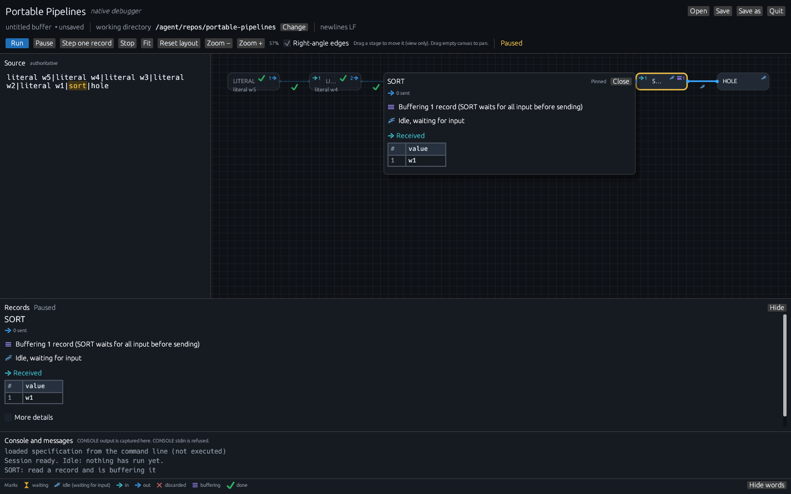

*SORT has read a record and is holding it. It has sent nothing. HOLE
still shows zzz: nothing has arrived, and HOLE is not finished.
Captured on Linux.*

Read that card slowly, because it is the whole point of this
walkthrough:

- The SORT box has `→ 1` (it has read one) and a stack with `1` (it is
  holding one). Out is `0 sent`.
- The sentence next to the stack is not decoration:
  **Buffering 1 record (SORT waits for all input before sending)**.
- **Idle, waiting for input** with zzz: SORT is still alive. It wants
  the rest of the fruits (here, `w5` … `w1`).
- **→ Received** already lists `w1`. Received is “what this stage has
  read,” not “what it has sent.”

> **What buffering means.** A buffering stage has taken records off
> its input and stored them inside. They are not waiting on a
> connection (that would be the hourglass) and they have not been
> discarded (that would be the X). They will be sent later, in the
> order that stage’s contract promises — sorted, for SORT; as a block,
> for BUFFER. The count on the stack is `received − sent − discarded`
> when that arithmetic is known. If it cannot be known, the stack
> still appears and the number does not.
>
> This is why SORT can look “stuck” if you only watch the output.
> Watch the stack. The stage is working.

Press **Step one record** a few more times if you want to see the
stack climb. Or press **Run** and let SORT take the rest, sort them,
and drain into HOLE.

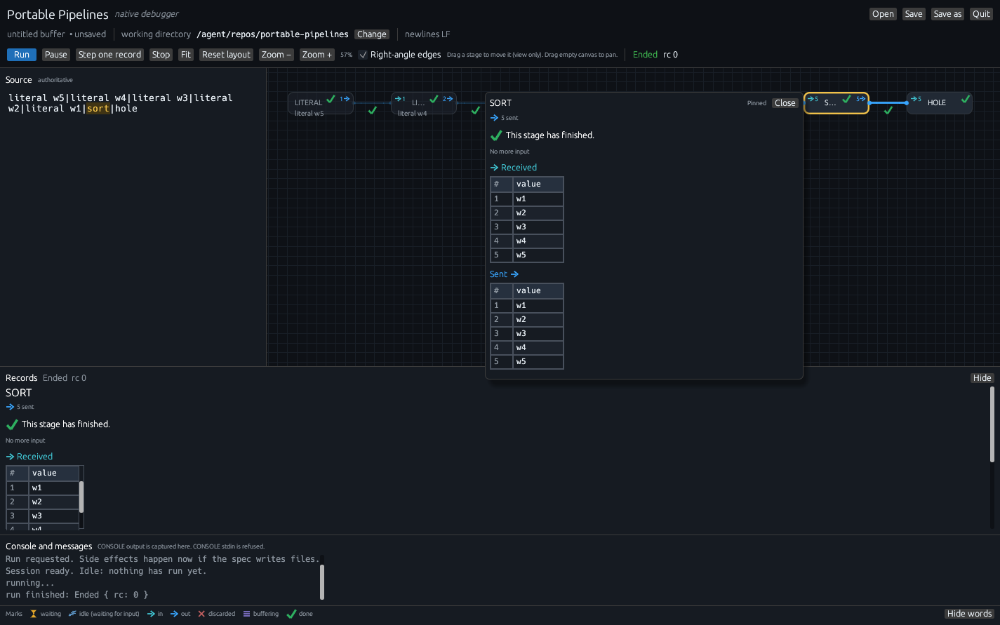

*Input ended, SORT sent everything it held, in order, and finished.
The stack is gone because nothing is inside any more. Captured on
Linux.*

The sent sheet is `w1`, `w2`, `w3`, `w4`, `w5`. That is SORT’s
contract, not the order LITERAL produced them. Received still lists
them in the order SORT *read* them (`w1` first in this session, then
`w2`, …), so you can see both stories at once.

A close-up of the holding state, without the rest of the window:

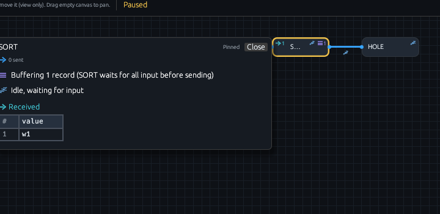

*The violet stack on the box is the same mark as the sentence in the
card. Captured on Linux.*

BUFFER is the same mark with a different reason. Any stage the run
summary lists with a stack is holding records inside.

## Python and REXX: script info and source view

A `.py` or `.rexx` file named as a stage is a program you wrote. The
box shows the **file name** and the language, not a generic PYTHON
verb. Topology, hover, and graph drawing do not open or run that file.

The example in the tree is `examples/upper.py`: it reads each record
and writes it in upper case. From the clone root, working directory
must be that root so the relative path resolves.

Paste:

```text
literal hello|examples/upper.py|console
```

On Windows the path in the specification can use a backslash:

```text
literal hello|examples\upper.py|console
```

Press **Run**. Click the middle box. It is titled **upper.py**, with
**Python** as the subtitle.

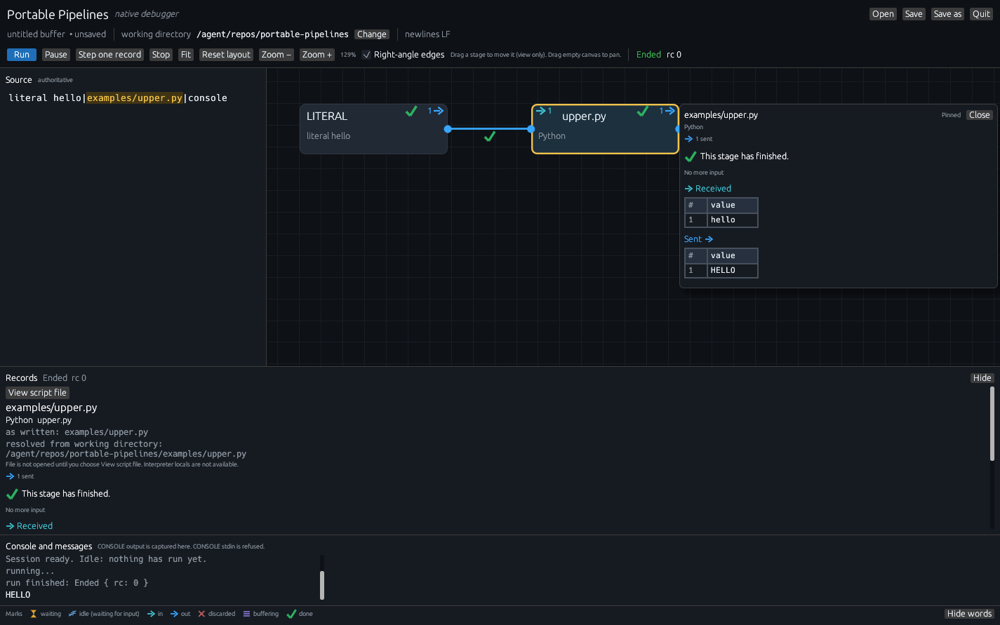

*The stage ran. CONSOLE printed `HELLO`. The script file still has not
been opened as a document — hover does not read it. Captured on Linux.*

The Records pane, with that stage selected, is doing several jobs at
once:

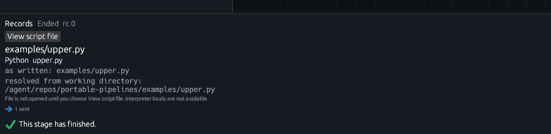

*Script identity. Read this before you click the button. Captured on
Linux.*

- **View script file** — a button. Nothing has been read from disk
  until you press it.
- **examples/upper.py** as the stage name.
- **Python  upper.py** — language and file name.
- **as written:** the verb exactly as the specification spelled it.
- **resolved from working directory:** the absolute path the helper
  will use. If this is wrong, press **Change** next to working
  directory, then Stop and Run again. A live session keeps the
  directory it started with.
- *File is not opened until you choose View script file. Interpreter
  locals are not available.*
- Then the ordinary record grid: **→ Received** `hello`, **Sent →**
  `HELLO`.

Press **View script file**. You can also right-click the box and choose
the same item.

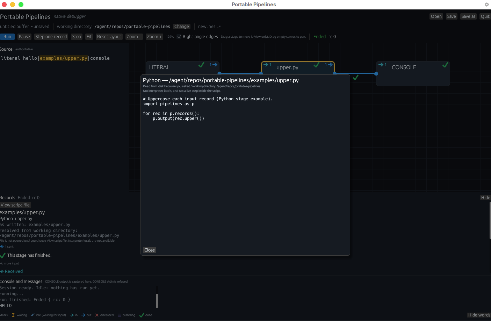

*A file view. Not pdb, not Regina trace, not stepping inside the
`for` loop. The pipeline has already finished; this is the source that
ran. Captured on Linux.*

The modal says three things on purpose, and they are the whole
contract:

1. **Python —** and the absolute path.
2. **Read from disk because you asked. Working directory:** … — so you
   can see which file, from which cwd.
3. **Not interpreter locals, and not a live step inside the script.**

The body is the bytes on disk at the moment you asked. If you edit
`upper.py` in another editor, this view does not auto-reload; close it
and choose **View script file** again. Edits to the *pipeline* source
do not change a session that is already live: Stop and Run to apply a
new spec. Edits to the *Python file* are the same idea: the helper
reads the file when the stage runs, not when the graph is drawn.

> **Why the box says `upper.py`, not `PYTHON`.** The stage verb *is*
> the path. `examples/upper.py` is a language stage because of the
> `.py` suffix. Writing `python examples/upper.py` as a verb asks for
> a built-in named PYTHON, which this port does not have; the box
> turns red and Run fails with **unknown stage PYTHON**. Use the file
> name. Arguments after the path (`examples\tuck.py owner`) show up as
> **arguments:** in the Records pane.

REXX is the same shape with a different helper. Paste:

```text
literal hello|examples/upper.rexx|console
```

```text
literal hello|examples\upper.rexx|console
```

Press **Run**, click **upper.rexx**.

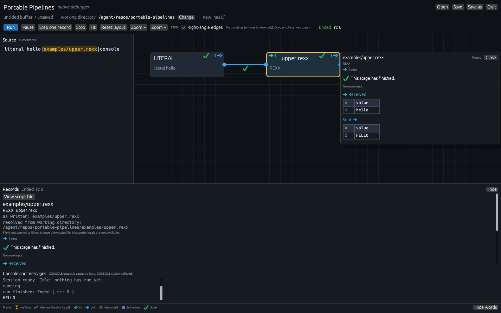

*Same walkthrough, Regina or the embedded subset on the host. The GUI
contract does not change. Captured on Linux.*

On Windows, release zips ship Regina next to `pipe.exe`. On Linux and
macOS, install Regina if you want `.rexx` stages to run through real
Regina; otherwise they use the embedded subset. See the
[v0.2.0 requirements](../release-notes-v0.2.0.md#requirements).
**View script file** still reads the `.rexx` bytes from disk either
way.

Right-click a script box for **Step this stage**, **View script file**,
and **Reset this node position**. Right-click empty canvas for
**Fit graph**.

## Spreadsheet columns: CSV in, JSON objects out

The first tutorial’s sheets had one column, **value**, because the
records were plain text (`apple`). When a record is a JSON object, the
window uses the field names as columns. It does this by looking at the
bytes. There is no table / text / hex switcher, and a raw CSV header
line is not split into columns until a CSV stage has parsed it.

Paste, from the clone root so `examples/orders.csv` resolves:

```text
< examples/orders.csv | csv | console
```

```text
< examples\orders.csv | csv | console
```

Press **Run**. Click **CSV**.

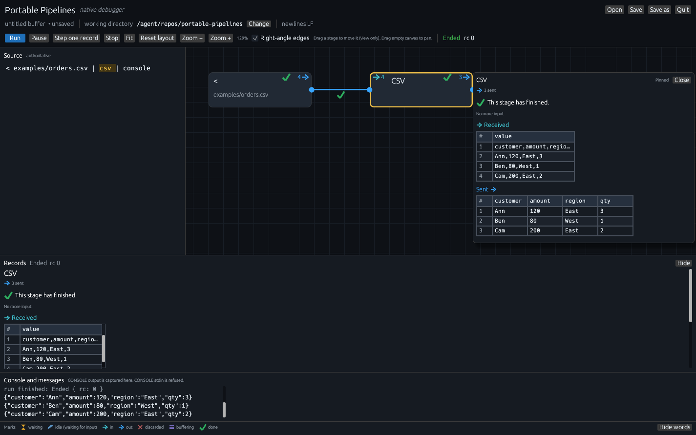

*The same stage, two layouts. Input is raw CSV text. Output is JSON
objects, so the sheet grows field columns. Captured on Linux.*

Notice that:

- `<` read four records (header + three rows) and shows `4 →`.
- CSV read four and sent three (`→ 4` and `3 →`). The header was
  consumed as names, not as a data row.
- **→ Received** still has a **value** column: `customer,amount,region,qty`,
  then `Ann,120,East,3`, and so on. Those bytes are not JSON yet.
- **Sent →** has columns **customer**, **amount**, **region**, **qty**.
  Ann / Ben / Cam. Long cells ellipsize; the full value is on hover.
- CONSOLE prints the JSON objects `pipe` would print:
  `{"customer":"Ann","amount":120,...}`.

That is the same story [JSON rows and CSV](../json-and-fields.md)
teaches from the command line. The debugger is showing you the moment
the records *become* objects.

Binary records (a digest, a JPEG fragment) show as hex in the sheet,
with a small **binary** label. Nested JSON objects become a nested
cell you can inspect from the Records pane; the hover card stays
compact and does not open that extra inspector.

If you send thousands of objects, you still get the last 1000 rows,
with the heading **Sent (showing last 1000 of N)** and row numbers
that keep the original sequence.

## A bigger picture: the marina CSV pipeline

The Cedar Cove example is a real fan-out: one JSONL file of vessels
becomes four CSV files (vessels, owners, berths, work orders). Open it
as a file so the window knows the path and the working directory:

```powershell
.\target\release\pipe.exe --gui examples\marina\to-csv.pipe
```

```bash
./target/release/pipe --gui examples/marina/to-csv.pipe
```

The graph fills with FANOUT, JSON KEEP, several CSV WRITE stages, SORT,
UNIQUE, and `<` / `>` boxes. Status is **Idle**. **About this pipeline**
(in Records, collapsed) will name the files it would read and write.
Nothing has been written yet.

Press **Run**, then click the first **CSV** box (the one that writes
vessels).

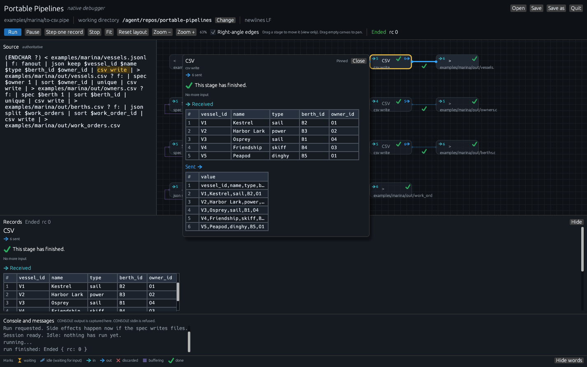

*Six vessel objects in, six CSV text records out. The other branches
of the FANOUT are the other CSV files. Captured on Linux.*

This is the picture the first tutorial was training you to read:

- Source on the left is the `.pipe` file, highlighted on the CSV span
  you selected.
- Each `>` box is a host file. Those writes happened when you pressed
  **Run**, not when the graph appeared. The console said as much
  before it ran: *Run requested. Side effects happen now if the spec
  writes files.*
- The CSV **→ Received** sheet uses the JSON field names from
  `json keep $vessel_id $name …`.
- The CSV **Sent →** sheet is the text lines that went to
  `examples/marina/out/vessels.csv` — one **value** column, because
  those records are CSV text again.

Quit aborts; it does not finish a paused marina run. Files already
written stay written. A host file syscall already in flight is not
interrupted; Quit waits a few seconds for that write, then the process
exits so `pipe --gui` can return.

The marina README is [examples/marina/README.md](../../examples/marina/README.md).
The JSON field language is [JSON rows and CSV](../json-and-fields.md).

## COMMAND, just looking

Paste:

```text
literal dir|command|console
```

Do not press Run yet.

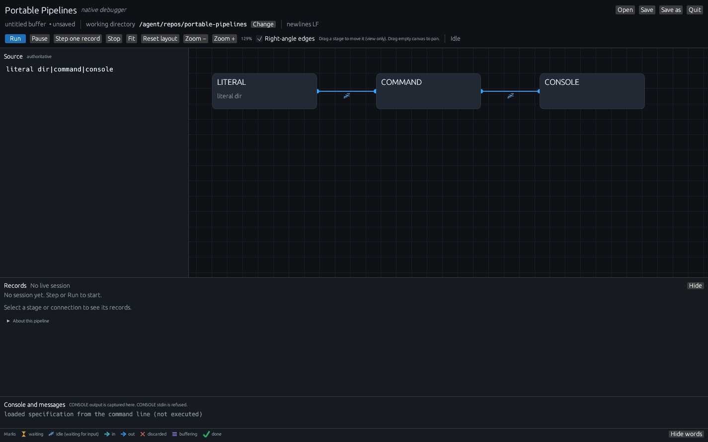

*COMMAND is a box with a name. It has not started a shell. Captured on
Linux.*

**About this pipeline** will mention that a COMMAND stage may run a
program on this computer when you Step or Run. On Windows, the helper
the GUI owns uses `CREATE_NO_WINDOW` so a cmd window does not flash;
a GUI program *you* start from COMMAND still shows its own window.
CONSOLE stdin is still refused.

That is the same “looking is free” rule as the first tutorial, with
higher stakes. Open the graph, decide whether you meant `dir` or
`Get-ChildItem` or `ls`, and only then press Run.

## What to keep from these four pictures

| Walkthrough | The mark that was the point |
|---|---|
| Secondary LOCATE | A second lane, no X, banana on **Sent on second output**. |
| SORT | Violet stack, “waits for all input before sending.” |
| `upper.py` / `upper.rexx` | File name + language; **View script file** reads disk on request. |
| CSV / marina | JSON objects become named columns; CSV text stays **value**. |

The [reference](reference.md) is the same window, described control by
control. The [glossary](glossary.md) is every word in the Marks legend
and on the badges. The [FAQ](faq.md) is “why did mine look different?”
